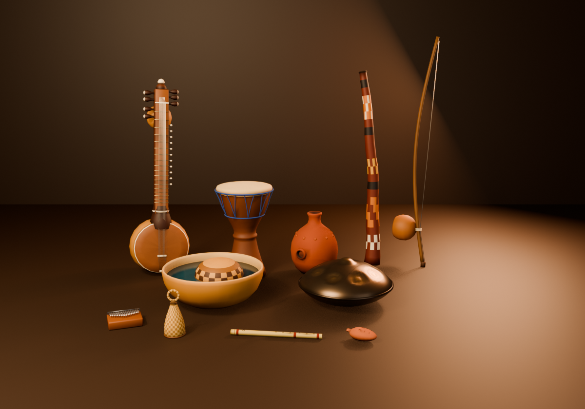

# Os instrumentos ancestrais (T49)

06/11/2026. Regra do dono: cada missão com pessoa dá, como **recompensa secundária**,
um instrumento ancestral/orgânico. Depois de ganho, ele fica na **casa da D-Bee**
(lugar `casa-dbee`, fim da estrada do deserto) e dá pra tocar.

## O que entrou

| Missão (quem) | Instrumento | Timbre (sintetizado) |
|---|---|---|
| dbee (D-Bee) | djembê | o tambor gravado da D-Bee; sem ele, grave/tapa sintetizados |
| oficina (o mecânico) | tambor de água | "glub" que sobe de tom |
| quadra (Alohan) | udu | grave de pote que cai de tom |
| drew (Drew) | caxixi | chocalho (ruído filtrado, duas batidas) |
| mubarak (Mubarak) | sitar | violão + corda de som.ts |
| xeriff (Xeriff) | didgeridoo | serra grave longa + oitava |
| lu2ca (LU2CA) | berimbau | corda + estalo |
| ella (Ella) | flauta de bambu | seno + sopro |
| notti (Notti) | ocarina | seno + sopro (mais agudo) |
| nizzy (Nizzy) | handpan | três senos (sino) |
| tony (Tony Gordo) | kalimba | seno + clique de lamela |

Túneis e a 13ª (final) não dão instrumento.

- **Tabela única:** `app/linha/disco/instrumentos.ts` (`INSTRUMENTOS_ANCESTRAIS`: id, artigo, nome,
  origem, missão, timbre, notas, cor; `tocarInstrumento`; `linhaRecompensa`).
  Trocar nome/missão/som é só ali. A missão → instrumento também aparece em
  `MISSOES13[...].recompensa.instrumento` (`app/linha/disco/portas.ts`).
- **Save:** `HistoriaDisco.instrumentos` (os ganhos) e `instrumentosVistos` (os já vistos na casa).
  Entram quando a porta abre (`portas.ts` `abrirPorta`); `instrumentosGanhos(h)` também deduz das missões feitas.
- **Recompensa:** ao fechar a missão, o notch passa a linha `+ o udu · na casa da D-Bee`
  (`page.tsx` `mostrarLiberou`), sem tela nova.
- **Na casa:** `app/linha/disco/InstrumentosCasa.tsx`. Os 11 têm vaga fixa no banco e nas duas
  prateleiras da parede direita. Ganho = com cor, tocável (cada toque anda nas notas, vira melodia).
  Não ganho = apagado + cadeado; tocar nele dá um toque abafado e a D-Bee diz na legenda
  "o udu ainda não tá aqui. vem da missão do Alohan". A parede só aparece depois do 1º ganho
  (no prólogo ela fica vazia).
- **Como chega lá:** a cena `dbee-instrumentos` (com instrumento novo, ela pede pra tocar os novos
  e segue sozinha depois; sem novo, a visita livre). Na visita livre não tem mais pressa: a dica
  tem um botão **pronto ›** (`cena.tsx` `Dica3d`) — antes ela saía depois de 2 toques.
- **Música:** na cena `dbee-instrumentos` a trilha para em fade e volta de onde estava ao sair
  (`page.tsx`, `fazerMusica`; bíblia §9: a música só para pra fazer música).
- **Desempenho:** geometrias e materiais criados uma vez no módulo e compartilhados; o não ganho usa
  um material só; nenhuma luz nova (a luz quente própria do banco, que existia, saiu); `useFrame`
  só mexe em quem foi tocado há < 0,6 s, sem alocar.
- **Teste:** Mesa (`app/teste/mesa.ts`, 06/11) → `?parte=instrumentos` (todos ganhos, visita livre);
  `?parte=casa.instrumentos` (7 ganhos, 2 novos, 4 trancados); `?parte=recompensa.instrumento`
  (fecha o Mubarak: "+ o sitar").

## Rascunho (o dono pode trocar)

- **Os sons:** todos sintetizados no Web Audio (menos o djembê, que usa o tambor gravado quando já
  carregou). Pra trocar por sample: mudar o `case` do timbre em `tocarInstrumento`.
- **Os modelos:** modelados no Blender (06/11), ver abaixo; as primitivas low-poly ficam de reserva.
- **A lista e quem dá o quê** (a tabela acima).

## Decisões tomadas sem perguntar

- O aviso do trancado é falado pela D-Bee na legenda (no mundo, sem rótulo flutuante/DOM em 3D).
- A visita livre não sai sozinha; sai no "pronto ›".
- A luz quente própria do banco foi tirada (regra: sem luzes novas). Se o banco ficar escuro, o
  ajuste é na luz da sala, não uma luz a mais.

## Modelados no Blender (06/11)

- **Scripts:** `blender/scripts/instrumentos.py` (modela os 11 com bmesh: torno de perfil, tubos, toros),
  `instrumentos_bake.py` (AO do Cycles assada na cor dos vértices, uma malha por material, exporta),
  `instrumentos_foto.py` (a foto acima). Headless, os três no mesmo Blender:
  `Blender -b --factory-startup --python instrumentos.py --python instrumentos_bake.py --python instrumentos_foto.py -- <bruto.glb> <foto.png> 1200`,
  depois `npx @gltf-transform/cli optimize bruto.glb public/models/instrumentos.glb --compress meshopt --simplify false --join false --flatten false --instance false --palette false`.
- **Arquivo:** `public/models/instrumentos.glb`, 16,4 mil triângulos, 249 KB (orçamento: 25 mil / 1 MB).
  Um nó por instrumento (o id), origem na base, metros, tamanho real; filhos `<id>_<material>`
  (madeira, barro, metal, palha, couro, corda, agua). Sem decimate (as estampas por face ficam).
- **Detalhes:** djembê com couro de borda irregular e a corda em V entre os dois aros; tambor de água com a
  cabaça pirografada boiando; udu com a boca, o furo do lado e as pelotas do ombro; caxixi trançado em xadrez com
  relevo e alça; sitar com a cabaça e o tampo, 18 trastes em arco (distâncias reais), 7 cordas, cravelhas grandes e
  as 11 pequenas, a cabaça de cima; didgeridoo torto, pintado em faixas, com o bocal de cera; berimbau com a verga em
  arco, o arame, o cordão e a cabaça aberta; flauta com o nó, o bocal, seis furos e três amarras; ocarina com bocal,
  janela e seis furos; handpan com o ding e oito campos de nota; kalimba com 17 lamelas em V, sela, barra e furo.
  Cordas, trastes e lamelas um pouco mais grossos que o real, pra ler no tamanho do jogo.
- **No jogo:** `InstrumentosCasa.tsx` carrega com `useGLTF` e escala cada nó pra maior medida da vaga de antes
  (`MEDIDA`), com as mesmas inclinações (`POSE`). Um material por grupo (cor dos vértices), compartilhado; o
  trancado usa o material apagado único; cadeado e toque iguais; nada por quadro além do balanço; sem luz nova.
  Enquanto carrega ou se falhar, as primitivas de antes.

## No mundo, na Kombi e na batida (09/11, bíblia §13)

"Espalhados pelo deserto e subúrbio; achou, pode tocar dentro da Kombi. A D-Bee tem alguns na casa
dela, onde dá pra tocar e samplear usando a batida."

- **Onde ficam:** `app/linha/disco/instrumentosMundo.ts` (`INSTRUMENTOS_MUNDO`: um ponto por instrumento,
  6 no deserto, 5 no subúrbio; `NO_MUNDO`: raios e escala). Sem ponto no mapa: é pra achar. RASCUNHO de posição.
- **Achar:** a Corrida confere de 250 em 250 ms; a 12 m de um que falta, avisa `instrumento:<id>` (`page.tsx`
  `onHistoria`): entra em `h.instrumentosAchados`, soa e passa no notch "+ o udu · toca na Kombi". Sem parar a Kombi.
- **Os marcos:** `InstrumentosNoMundo.tsx`. Pedras + anel + luz baixa na cor dele, um desenho só por material;
  o modelo real (o mesmo `instrumentos.glb`) só monta a menos de 140 m. Nada por quadro.
- **Na Kombi:** `app/linha/estrada/InstrumentosKombi.tsx`, prateleira na parede de ripas em cima do sofá
  (olhar pra esquerda de dentro). Tudo que ele tem: achados e ganhos em missão (decisão do dono, 09/11). Tocar para a trilha (bíblia §9) e ela volta 5 s depois do último toque.
- **Na casa:** a caixa de pads na mesa (`InstrumentosCasa.tsx`, `Sampler`). Toca um instrumento, toca a caixa:
  entra em `h.instrumentosSampleados` e o B4TIDA abre por cima (`BatidaCasa.tsx`, `/batida?sample=<id>`) com uma faixa desse som
  na música "samples da D-Bee" (a música do jogador não é tocada). Só vale no gesto de tocar os instrumentos.
- **O som no B4TIDA:** `"anc:<id>"` (`batida/estudio/sons.ts`), desenhado num OfflineAudioContext
  (`disco/instrumentoAmostra.ts`) com a MESMA receita do jogo (`instrumentos.ts` `soarTimbre`); o djembê usa o tambor gravado.
  Na bateria, cada pad é uma nota dele; os afinados também aparecem nos instrumentos melódicos. A lista sai do save.
- **Save:** só campos novos e opcionais; save antigo lê `?? []`. Os da missão seguem em `h.instrumentos`: a casa mostra só esses, sem instrumentos iniciais (dono, 09/11); o marco de um que ele já tem some do chão; achar não mexe neles.
- **Teste:** Mesa → `?parte=instrumentos.mundo`, `?parte=instrumentos.kombi`, `?parte=instrumentos`.
